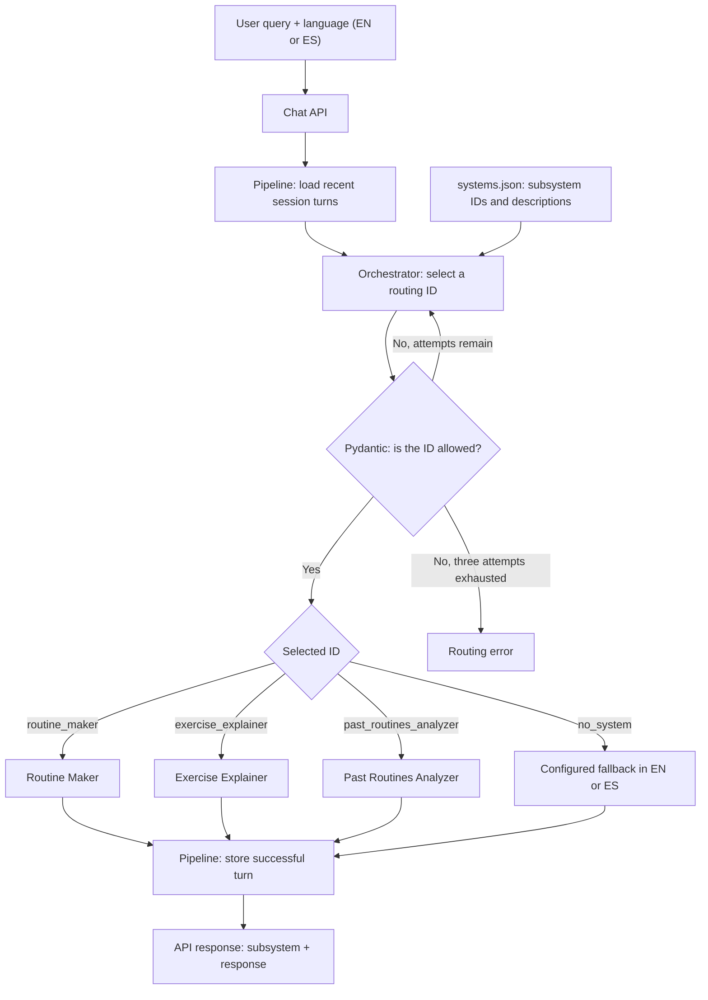
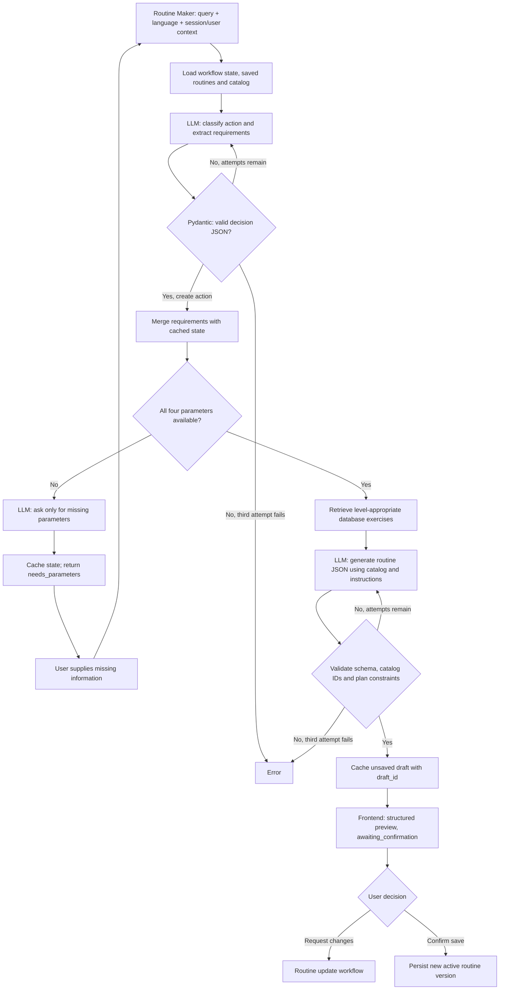

# Orchestrator App Repo

An agentic AI system connected to a SQL database that demonstrates how modern AI applications work and how natural-language queries can be routed to different integrated AI systems based on user intent.

## 1. Overview

Modern general-purpose AI chat applications, such as ChatGPT, Gemini, and Claude, can bring multiple AI capabilities and systems together in a single conversational interface. A key part of this experience is routing each user's request to the appropriate system based on their intent.

In this project, we call the component responsible for that routing the **orchestrator**. Using a list of available AI systems and capabilities, the orchestrator relies on a large language model (LLM) to decide where to send each query.

Although orchestration can become complex, this project presents a simple architecture and design, showing how an orchestrator can be integrated into an application for a realistic use case.

The project also includes:

- **A React frontend** with a chat interface and a button that lets users inspect what happens behind the scenes to understand how the system works.
- **A Terraform module** for provisioning the proposed Google Cloud Platform (GCP) infrastructure, including a virtual machine, databases, and secrets.
- **A deployment workflow** designed for a production environment, with pull request checks for changes coming from a development branch. To reduce costs for demonstration purposes, development runs locally rather than in a separate cloud environment.

Feel free to clone this repository and use it as a starting point for your own project.

## 2. Business Overview, Use Case, and Value

The selected use case is **Form**, a gym application. Fitness is a familiar topic for many people, making the example easy to understand and its underlying patterns easy to apply to other business needs.

Form lets users interact with a virtual fitness trainer through a chatbot and record their workout progress. The chatbot supports three tasks:

1. **Explain an exercise**, using exercise information and reference images.
2. **Create a workout routine**.
3. **Show the user's progress**, helping them review past workouts.

These tasks address common needs for gym users: planning routines, following them during training, reviewing previous workouts to support progressive overload, and clarifying how to perform exercises. And yes, this use case was inspired by being a gym rat.

### How the Use Case Works

The application combines an orchestrator, a SQL database storing users, routines, exercises, and workout records, and an image repository containing exercise illustrations.

The orchestrator identifies which of the three supported tasks matches the user's intent and routes the request to the appropriate specialized agent. That agent carries out the task under strict instructions, with observability measures and controlled database access. Rather than generating arbitrary SQL, agents supply parameters to predefined SELECT queries to retrieve the information they need.

Users can also access their saved routines directly in the **Routines** tab. The application uses the information stored in the database to present routines and workout records through a structured interface, not just through chat.

### Business Value

Although Form focuses on fitness, the same approach can be applied to many business scenarios:

- **Focused AI assistance:** support a defined set of business tasks rather than an unrestricted chatbot.
- **Intent-based routing:** direct each request to the agent or system responsible for that task.
- **Controlled data retrieval:** retrieve database information through predefined, parameterized queries, reducing the risk of incorrect queries.
- **Structured data presentation:** make stored information available through a clear application interface as well as conversational responses.
- **Access to unstructured resources:** retrieve supporting assets, such as images, from repositories outside the relational database.
- **Extensibility and observability:** incorporate additional AI systems over time while maintaining strict observability across routing decisions and task execution.
- **Infrastructure as Code (IaC):** define infrastructure in version-controlled code to support collaboration and repeatable deployments across environments.

## 3. Repository Structure

The application is organized into three main modules: **infra**, **backend**, and **frontend**. A supporting **database** directory includes a SQLite database and its schema, while **scripts** contains utilities for migrating database data and exercise images. The deployment workflow lives in **.github/workflows**.

The following tree highlights the main directories and files; individual source files and supporting assets are omitted for readability.

```text
OrchestratorApp/
|-- .github/
|   `-- workflows/
|       `-- terraform-deploy.yml     # Infrastructure and deployment workflow
|-- backend/
|   |-- src/                        # API, orchestration, and AI system implementation
|   |-- tests/                      # Backend tests
|   `-- pyproject.toml              # Backend dependencies and configuration
|-- frontend/
|   |-- public/                     # Public assets
|   |-- src/                        # React application
|   |-- tests/                      # Frontend browser tests
|   `-- package.json                # Frontend dependencies and commands
|-- infra/
|   |-- environments/
|   |   `-- prod/                   # Production Terraform configuration
|   |-- modules/
|   |   |-- artifact_registry/
|   |   |-- cloudrun/
|   |   |-- database/
|   |   |-- secrets/
|   |   `-- storage/
|   `-- scripts/                    # Infrastructure access bootstrap scripts
|-- database/
|   |-- database_schema.json        # Database schema reference
|   `-- gym_app.db                  # SQLite database
|-- scripts/
|   |-- migrate_database.py         # Database migration utility
|   |-- migrate_images.py           # Exercise image migration utility
|   `-- registry_images.py          # Exercise image registration utility
|-- src/
|   `-- orchestratorapp/            # Root Python package
|-- .env.example                    # Example environment configuration
|-- Dockerfile                      # Container image definition
|-- pyproject.toml                  # Root Python project configuration
|-- uv.lock                         # Root Python dependency lockfile
`-- README.md
```

## 4. Technology Stack Used

### 4.1 Backend

The backend uses **Python** and **FastAPI**. Rather than relying on an agent orchestration framework, it uses custom Python classes to make API calls, integrate agents, and coordinate task execution.

- **Pydantic** validates structured LLM outputs.
- **Google's Gemini API**, accessed through Google AI Studio, provides the models used by the AI systems.
- **uv** creates the virtual environment and manages Python dependencies.

### 4.2 Frontend

The frontend uses **React**, with **Vite** and its React plugin for development and builds, and **Tailwind CSS** for styling.

The **UI/UX Pro Max skill**, used with Claude, supported the interface design process to improve usability and the overall user experience.

### 4.3 Infrastructure

The infrastructure uses **Terraform** for Infrastructure as Code (IaC), **Docker** for containerization, and **GitHub Actions** for automated infrastructure and application deployment.

The deployment combines Google Cloud Platform (GCP) services with a Neon database:

- **Cloud Run** hosts a single container image containing both the frontend and backend.
- **Artifact Registry** stores the application's container images.
- **Neon PostgreSQL**, using a free subscription for this demo, provides the production SQL database.
- **Google Cloud Storage** provides a bucket for exercise images.
- **Secret Manager** stores application secrets and database connection credentials.

## 5. How the Agent System Works

When the frontend sends a user query and response language to `POST /{id}/chat`, the backend starts the agent pipeline. The session `id` provides conversation context; routine creation and history analysis also require a `user_id`.

The **orchestrator runs first** to identify the user's intent. It selects a subsystem, but does not execute it or answer the question itself. The **pipeline** then invokes only the selected subsystem and returns its response.



The selected subsystem receives the original query and requested language, along with the context it needs. For example, Routine Maker uses session/user-scoped draft state, while the exercise and history systems can use recent conversation turns. Successful turns are stored for subsequent follow-ups; the chat endpoint currently supplies the latest two turns to the pipeline.

The main entry points are the [chat endpoint](backend/src/api/Endpoint/chat.py) and the [Pipeline](backend/src/systems/pipeline/Pipeline.py). The default API response contains `subsystem` and `response`; clients can also request an NDJSON stream containing progress events and a terminal result or error.

### 5.1 First Step: The Orchestrator

The [Orchestrator](backend/src/systems/orch/Orchestrator.py) receives the user query and uses [systems.json](backend/src/config/systems.json) as its default catalog of available systems. The configuration contains:

- **A language map:** `ES` means Spanish and `EN` means English.
- **Subsystem definitions:** each has an `id`, a name, and a description explaining when it should be selected.

The three configured subsystems are:

| Routing ID | Responsibility |
|------------|----------------|
| `routine_maker` | Create or modify workout routines and handle routine-workflow follow-ups and confirmations. |
| `exercise_explainer` | Explain exercise execution, technique, setup, and common mistakes. |
| `past_routines_analyzer` | Retrieve and analyze past routines, logged workouts, and training progress. |

The language map documents the supported languages; the routing code validates `EN` and `ES` explicitly. The LLM receives the selected language code, not the entire language map.

#### Instructions and LLM Context

The [orchestrator prompt](backend/src/config/prompts/orchestrator/orchestrator.yaml) supplies the routing instructions as a separate system message. The user message contains a JSON payload with the original `query`, the configured `subsystems`, the requested `language`, and recent conversation `memory` when available.

The instructions tell the LLM to compare the query's intent with the subsystem descriptions and return **exactly one plain-text routing ID**. It must not answer the query, invoke a subsystem, return JSON, or add an explanation. For an unsupported request, it must return the reserved ID `no_system`.

#### Validation, Retries, and Fallback

The [Pydantic routing model](backend/src/utils/orch/dataclass/models.py) validates the returned value as a strict string belonging to the configured subsystem IDs or `no_system`. Extra text, an invented ID, or any other invalid selection is rejected.

The [routing helper](backend/src/utils/orch/func/route.py) logs rejected selections and repeats the LLM consultation with the same routing context, allowing **three attempts in total**. If all three fail validation, it raises an error rather than silently selecting a subsystem. Provider or configuration failures also propagate as errors; they are not converted into a no-match response.

A valid `no_system` selection is different from a routing failure. In that case, the pipeline returns a predefined message from the [fallback configuration](backend/src/config/prompts/nosystem/nosystem.yaml) in the requested language, without another LLM call. The message explains that the application supports routine creation, exercise explanations, and past-routine analysis.

### 5.2 Routine Maker

When the orchestrator selects `routine_maker`, the subsystem loads the user's session-scoped workflow state, saved routines, and exercise catalog. It uses separate LLM stages to identify the requested action, collect missing information, and generate or update a routine. The following flow focuses on **creating a new routine**.

#### Collecting and Validating Requirements

The first LLM call classifies the turn and extracts the requirements explicitly supplied by the user. Its JSON response includes the action (`create`, `update_saved`, `update_draft`, `save`, or `no_match`), extracted parameters, and any requested exercise changes.

For routine creation, the required parameters are:

| Parameter | Accepted values | Purpose |
|-----------|-----------------|---------|
| `routine_type` | `weider` or `ppl` | Select the workout split: Weider or push/pull/legs. |
| `days_per_week` | Integer from 1 to 7 | Define the number of training days. |
| `hours_per_session` | Positive number, at most 24 | Limit the available time per session; user-supplied minutes are converted to hours. |
| `level` | `beginner`, `intermediate`, or `advanced` | Adapt the routine and filter eligible exercises. |

The backend validates the JSON with Pydantic **before checking whether requirements are complete**. Invalid structured output is retried with validation feedback, for **three attempts in total**. Valid requirements are merged into the cached workflow so users can provide them across multiple turns; missing values are not replaced with invented defaults.

If any required parameter is still absent, routine generation pauses. A separate LLM call asks only for the missing information in the requested language, and the backend returns `status: needs_parameters`. The next user reply resumes the workflow using the stored requirements.

#### Generating and Validating the Routine

Once all requirements are available, the backend retrieves exercises from the database at or below the user's experience level. The generation LLM receives this catalog, the collected parameters, accumulated user requests, the routine JSON schema, and the [Routine Maker instructions](backend/src/config/prompts/routinemaker/routinemaker.yaml).

These instructions require the model to respect the selected split, training frequency, session time, user preferences, and safety guidance. **Only exercises from the supplied database catalog may be selected.** The generated JSON contains:

- **Routine:** `name`, `summary` explaining the plan, `days`, and `recovery` guidance.
- **Each training day:** `day`, `day_type`, `info` containing warm-up/focus guidance, `duration_minutes`, and `exercises`.
- **Each exercise:** `exercise_id`, `name`, `sets`, `reps`, `rest_seconds`, and `notes`. The backend fills exercise names from the catalog rather than trusting model-generated names. Time or distance targets can be represented in `reps`, with clarification in `notes`; generated plans do not prescribe weights.

The [Pydantic models](backend/src/utils/routinemaker/dataclass/models.py) validate the plan's structure and constraints, including the required number of consecutive training days, session duration limits, valid sets and rest intervals, catalog membership, and no duplicate exercise IDs within a day. Invalid plans receive validation feedback and are regenerated, again with **three attempts in total**. Exhausted validation retries raise an error; provider failures are not silently converted into a preview.

#### Returning the Preview

The validated routine is cached as an **unsaved draft** with a unique `draft_id`. The API sends the frontend a `routine_maker` response containing `status: awaiting_confirmation`, the collected `parameters`, a localized `message`, the structured `routine`, and the `draft_id`. The `routine_id` remains null until persistence succeeds.

The user can review the preview, request changes, or explicitly confirm saving. Generation alone does not save or activate a routine. Confirmation persists a new version and makes it the current routine; the direct save endpoint confirms the cached draft without another LLM call.



The stage coordination, retry loops, and confirmation handling are implemented in the [Routine Maker workflow](backend/src/utils/routinemaker/func/handle.py).